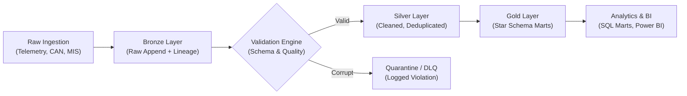

<!-- Assets are self-hosted via tools/make_assets.py -->

  

 

 

**Automotive Data Engineer** specializing in converting high-frequency simulation traces, vehicle IoT telemetry, and supply-chain records into clean, idempotent, analytics-grade lakehouse tables.

---

## 🛠️ Engineering Principles

* **Quarantine over dropping:** Invalid records are captured into dead-letter tables with explicit error metadata for lineage tracing.
* **Idempotence by default:** Pipelines allow deterministic re-runs without duplicate side effects or orphaned records.
* **Deterministic ground-truth testing:** Pipeline outputs are validated against independent standalone computation models before merging.
* **Strict schema governance:** Enforced contracts at the ingestion boundary before promotion to Gold/Marts.

---

## 🏗️ Architecture Pattern

---

## 🚀 Featured Lakehouse Projects

### 1. [Automotive Simulation Data Lakehouse](https://github.com/himanshuupadhyay300/automotive-simulation-lakehouse)
> **Stack:** PySpark · Spark SQL · Delta Lake · Signal Processing · pytest
* Engineered an automated lakehouse ingesting high-frequency Simulink/CAN vehicle simulation exports.
* Converted raw dynamic signals into discrete threshold-event telemetry (overheating, undervoltage, harsh deceleration).
* **Ground Truth Parity:** Benchmarked Spark transformation against an independent Python engine with 100% agreement (22/22 events validated).
* Built auto-healing pipelines where re-exporting repaired telemetry seamlessly reconciles historical Gold layers.

### 2. [Automotive MIS & KPI Analytics](https://github.com/himanshuupadhyay300/Automotive-MIS-KPI-Analytics-PySpark-SQL-Azure)
> **Stack:** Azure Data Factory · Delta Lake · Star Schema · Dimensional Modeling
* Designed a multi-tier dimensional lakehouse pipeline modeling retail sales, dealer targets, and tractor inventory movements.
* Configured automated late-arriving dimension handling, reconciliation checks, and duplicate deduplication.
* Built 4 business-critical SQL marts (dealer target attainment, inventory turnover, ABC classification, monthly trends) matching finance accounting baselines.

### 3. [IoT Vehicle Telemetry Pipeline](https://github.com/himanshuupadhyay300/iot-vehicle-telemetry-pipeline)
> **Stack:** Medallion Architecture · Azure Databricks · ADLS Gen2 · Event Hubs
* Built an end-to-end streaming/batch vehicle telemetry pipeline with Medallion architecture.
* Implemented schema drift detection, corrupted payload isolation, and idempotent upserts to Delta Lake.
* Includes automated data health scoring and alerting templates for missing sensor heartbeats.

---

## 🧰 Technology & Ecosystem

  

| Layer | Technologies |
|---|---|
| **Core Languages** | Python, PySpark, Spark SQL, SQL, MATLAB / Simulink |
| **Azure Lakehouse** | Azure Databricks, Delta Lake, ADLS Gen2, Azure Data Factory |
| **Data Architecture** | Medallion Architecture, Star Schema, Ingestion DLQ, SCD Type 1/2 |
| **Reliability & DevOps**| pytest, CI/CD (GitHub Actions), Git, Schema Enforcement |

---

## 📈 Roadmap & Continuous Improvement

- [x] Simulation signal validation and event boundary generation
- [x] Dimensional modeling & inventory reconciliation framework
- [ ] Production Delta Lake integration on cloud Databricks workspace
- [ ] End-to-end Power BI KPI dashboard layer for MIS data marts
- [ ] Automated SCD Type 2 dimension historical tracking

---

## 📬 Get in Touch

&nbsp;

*Open to Data Engineer and Azure Lakehouse roles across Noida, Greater Noida, and Remote.*
