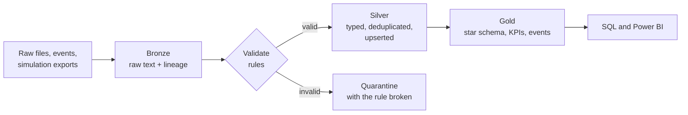

<!-- Graphics are self-hosted in /assets and generated by tools/make_assets.py (no third-party widgets that can break). -->

  

 

**I turn messy automotive data (vehicle telemetry, sales and inventory, simulation outputs) into clean, tested, analytics-ready datasets.**

🟢 **Open to:** Azure Data Engineer roles · remote, or Noida / Greater Noida

&nbsp;

## What I do

- Build **ETL/ELT** pipelines on **Azure** (ADLS Gen2, Databricks, Data Factory) with **PySpark**, **Spark SQL** and **Delta Lake**
- Design **data models** (star schema, Medallion layers) and the **SQL** KPI layers on top of them
- Make data trustworthy: validation, quarantine of bad records, duplicate and late-data handling, idempotent reruns, automated tests

## Right now

- **Role:** Azure Data Engineer · Assistant Manager, Data Management at International Tractor Limited (previously Software Engineer at Expleo)
- **Based in:** Noida / Greater Noida, India
- **Portfolio:** three end-to-end projects below, each with tests, CI and an honest "what is verified" section
- **Next on my roadmap:** verifying the Delta Lake path on a real Databricks workspace · a Power BI report for the MIS project · SCD Type 2 dimensions

&nbsp;

## Featured projects

**[Automotive Simulation Data Lakehouse](https://github.com/himanshuupadhyay300/automotive-simulation-lakehouse)** · PySpark · Spark SQL · Delta Lake
Simulink-style run exports become validated signals, then threshold events (overheating, undervoltage, hard braking, overspeed). The Spark results are identical to an independent plain-Python implementation (22 of 22 events), and re-exporting a bad run heals its events automatically.

**[Automotive MIS & KPI Analytics](https://github.com/himanshuupadhyay300/Automotive-MIS-KPI-Analytics-PySpark-SQL-Azure)** · star schema · SQL marts · Power BI design
Dimensional model with four SQL KPI marts (monthly trend, dealership target attainment, product ABC, inventory movement). Handles late sales, corrections and duplicates; an inventory reconciliation check flags exactly the weeks with missing sales; revenue and profit match an independent calculation.

**[IoT Vehicle Telemetry Pipeline](https://github.com/himanshuupadhyay300/iot-vehicle-telemetry-pipeline)** · Medallion · ADF and Databricks templates
Bronze, Silver and Gold pipeline with schema enforcement, quarantine, idempotent incremental loads and a data quality report.

All data is synthetic. Every repo separates what is tested and run from what is a documented template or design.

&nbsp;

## How I build pipelines

- **Quarantine, don't drop.** A rejected record keeps its raw values and the rule it broke.
- **Idempotent by design.** Running a load twice changes nothing.
- **Verify against something independent.** Expected results are computed separately from the pipeline, then compared.
- **Say what is tested.** Implemented, templated and proposed work are labelled as such.

&nbsp;

## Tech stack

&nbsp;

## Get in touch

&nbsp;

Happy to talk about data engineering on Azure, automotive data, or anything in the projects above.
